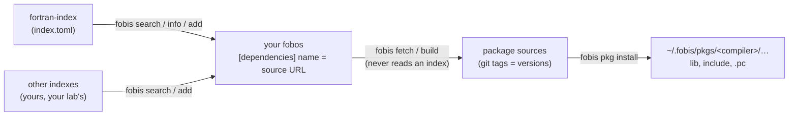

## Quick start

```bash
fobis index add szaghi https://github.com/szaghi/fortran-index
fobis search json
fobis search --module m_cli2
fobis info json-fortran
```

In a project:

```bash
fobis add json-fortran
fobis fetch
fobis build
```

`fobis add` writes `json-fortran = https://github.com/jacobwilliams/json-fortran :: semver=^9.3.1` into the fobos.

For your compiler, outside any project:

```bash
fobis pkg install M_strings
export PKG_CONFIG_PATH=$(fobis pkg path M_strings --pkgconfig)
gfortran main.f90 $(pkg-config --cflags --libs M_strings)
```

Requires FoBiS.py 3.11 or newer (`pip install --upgrade FoBiS.py`).

## How it fits together



## Authors

- Stefano Zaghi — [@szaghi](https://github.com/szaghi)

Every package belongs to its authors: the index lists where to find them. Contributions are welcome — see the
[Contributing](/reference/contributing) page.

## Copyrights

The index (`index.toml`, `seeds.toml`) and this documentation are released under
[CC0-1.0](https://creativecommons.org/publicdomain/zero/1.0/): no rights reserved. Each listed package keeps its own
licence, shown in the [catalogue](/packages/).
